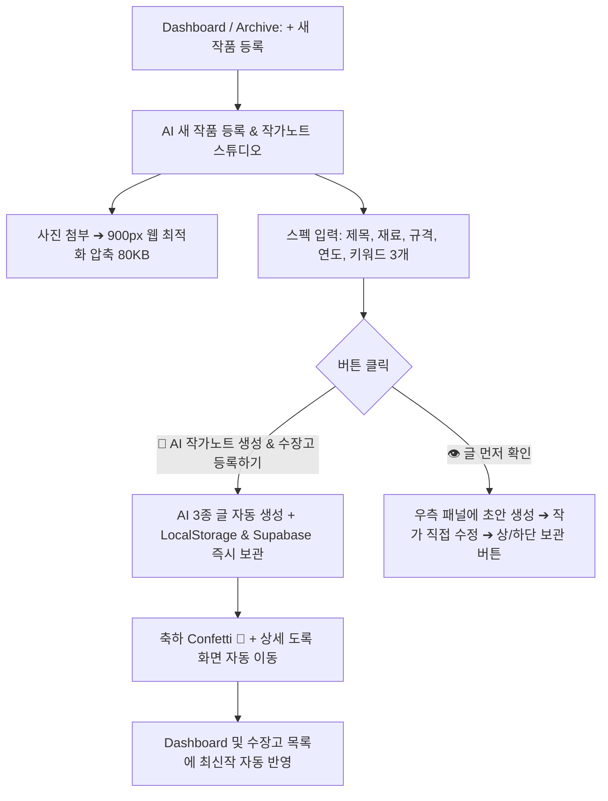

# 🎨 수장고(Sujango) - AI 새 작품 등록 & 작가노트 스튜디오 통합 및 로컬스토리지 최적화 지식 노트

- **서비스명:** Sujango (수장고) - 창작자를 위한 프라이빗 디지털 수장고
- **고유 포트:** 5198
- **저장소:** https://github.com/ARA3827/sujango.git
- **배포:** Vercel 자동 배포 연동 (`main` 브랜치)
- **최종 커밋:** `04bd496`
- **작성일자:** 2026-10-17

---

## 1. 당일 주요 개선 및 문제 해결 내역

### 1-1. '새 작품 등록'과 '작가노트 스튜디오'의 완전한 원스톱 통합
- **기존 문제:**
  - 메인 대시보드에서 `[+ 새 작품 등록]`을 클릭하면 신규 등록 폼이 아닌 이미 등록된 첫 번째 작품(《봄의 품격》)의 상세 도록 페이지가 열리는 혼선 발생.
  - 새 작품 등록 폼과 작가노트 스튜디오의 입력 항목(사진, 제목, 크기, 재료 등)이 중복되어 작업 동선이 파편화됨.
- **해결책:**
  - `StatementStudio.jsx`를 **[AI 새 작품 등록 & 작가노트 스튜디오]**로 전면 고도화.
  - 대시보드 및 수장고 상단에서 `[+ 새 작품 등록]` 클릭 시 다이렉트로 통합 스튜디오로 연결.
  - 작품 정보(사진, 제목, 규격, 재료, 연도, 키워드 3개)를 입력하고 메인 버튼을 누르면 **AI 글 3종(미술평론 작가노트, 전시 캡션, 인스타 피드 글)을 즉시 생성함과 동시에 작가님의 수장고에 원클릭으로 자동 안전 보관**되도록 파이프라인 완성.

### 1-2. 고화질 사진 업로드 시 브라우저 LocalStorage 5MB 한도 방어
- **발생했던 버그:**
  - 사용자가 《맹호도》 고화질 사진을 첨부하고 `[이 작품을 내 수장고에 보관하기]`를 눌렀으나, LocalStorage 5MB 용량 한도 초과(`QuotaExceededError`)로 인해 저장이 거부되어 목록에 반영되지 않는 치명적 실무 문제 발생.
- **해결책:**
  - `compressImage` 파라미터를 `maxWidth: 900, quality: 0.75`로 튜닝하여 육안 화질 손상 없이 이미지 용량을 80~150KB 수준으로 1/10 압축.
  - `archiveStorage.js` 내에서 LocalStorage 저장 시 예외 처리 및 슬림 모드 재시도 방어 로직 구축.

### 1-3. 카피라이팅 & 신뢰감 제고 (AGENTS.md 준수)
- 화면 전체에서 과장되거나 부담스러운 **'영구'** 단어를 전면 제거:
  - `이 작품을 내 수장고에 영구 보관하기` ➔ `이 작품을 내 수장고에 보관하기`
  - `기기에 영구 보관합니다` ➔ `기기에 안전하게 보관합니다`
  - `영구히 보관하세요` ➔ `안전하게 보관하세요`
- 창작배경/영감메모 입력칸의 텍스트를 진한 검은색 기본값 대신 연한 회색의 가이드(placeholder)로 변경하여 지우는 수고 제거.

---

## 2. 핵심 아키텍처 및 데이터 흐름

---

## 3. 1인 창업가 멘토링 핵심 체크리스트
1. **사용자의 직관 존중:** 사용자가 큰 버튼을 눌렀다면 "저장까지 원스톱으로 끝났다"고 느끼는 것이 당연하다. 2번의 클릭이나 스크롤 아래 숨겨진 저장 버튼을 강요하지 말 것.
2. **로컬스토리지 5MB 한계 사전 차단:** 모바일/카메라 고화질 사진은 반드시 클라이언트에서 100KB 미만으로 경량화 압축 후 저장해야 안정적인 서비스 제공 가능.

---

## 4. 서브페이지 7대 핵심 정돈 및 팩트 컴플라이언스 (2026-10-22)

### 4-1. 계정 및 인증 팩트 안내 (1번)
- 현재 계정/인증은 서버나 클라우드가 아닌 **사용자 브라우저 `localStorage`에만 세션 형태로 작동**.
- 비밀번호는 브라우저 로컬스토리지에 평문(Plain text) 저장 중이므로 다른 기기 연동 불가.
- 다음 단계에서 **Supabase 클라우드 열쇠(URL/Anon Key) 연결**을 통해 실제 서버 계정 발급, 이메일 인증, 약관 동의 체크박스(이용약관/개인정보 처리방침) 파이프라인으로 전환 예정.

### 4-2. AI 작가노트 생성 정확성 (`StatementStudio.jsx`)
- 입력칸이 비어 있을 때 placeholder(예시 문구: "빛과 어둠의 경계에서...")가 AI 프롬프트에 들어가 글을 왜곡하던 문제 원천 차단.
- 재료 맞춤 텍스트 생성: '지본채색/한지/종이' 입력 시 한지의 결/스며듦, '유화/아크릴'은 물성의 층위, '도예'는 흙과 불 등 실제 재료를 반영하도록 분기. 미입력 시 '캔버스'를 날조하지 않도록 방어.

### 4-3. 불필요한 이모지 제거 & 신뢰감 확보
- 전시 캡션 출력기 스타일 탭(🏛 ⬛ 🔴) 및 미리보기(✂️, 📄) 이모지 삭제.
- 작가노트 상단 타이틀 `✍️`, 빈 화면 `✨`, `📁` 이모지 제거.
- 로그인창 💡 팁 이모지 제거.

### 4-4. 화면별 용어 및 카피라이팅 통일
- 작가노트 결과 탭 이름 통일: `작가노트 / 인스타그램 캡션 / 블로그 글`.
- 헤더 복귀 버튼: `← 내 수장고`로 직관적 통일.
- 메인 타이틀: `나의 작품 수장고`, 설명: `작품 사진과 작가노트, 캡션 정보를 작품별로 보관하세요.`.
- 수장고 상세 타이틀: `작품 시각 자산` ➔ `작품 이미지`.
- 로그인 모달 하단 `공식 암호화 보안 프로토콜로...` 과장 문구 숨김 처리.

### 4-5. 수장고 상세 (`ArchiveStudio.jsx`, `index.css`)
- `CLOUD_ENABLED = false` 상태에 맞추어 `Pro 배지` ➔ `Pro 베타 신청`으로 사실 기반 표기.
- 실제 이미지 자동 합성이 아직 미완성인 `워터마크 설정` 버튼 주석 숨김 처리.
- 작품 프레임 배경색: 어두운 남색(`#0F172A`) ➔ 밝은 갤러리 회색(`#F1F5F9`)으로 전환하여 다양한 작품 색조 온전 감상.

### 4-6. 전시 캡션 출력기 (`CaptionStudio.jsx`)
- 영문 제목(`titleEn`) 및 영문 재료(`mediumEn`) 입력란 복원 및 수장고 불러오기 연동.
- 수장고에서 이미 불러온 작품은 `수장고에도 함께 보관하기` 체크박스 숨김 처리.
- 인쇄/PDF 출력 시 상단 수장고 연동 안내 배지가 인쇄물에 나오지 않도록 `@media print` 스타일 처리.

### 4-7. 서류·출강 스튜디오 (`DocStudio.jsx`)
- 장르 선택(한국화/서양화/수채화/드로잉/도예/공예 등)에 따라 재료비 기본 규격 자동 세팅, 미입력 시 빈칸 유지, 미리보기 셀 `contentEditable` 지원.
- 강사명 옆 불필요하게 튀는 빨간 원형 도장 테두리 ➔ 단정한 `(인)` 텍스트로 교체.

### 4-8. 창작 가계부 (`TaxStudio.jsx`)
- 4대 요약 카드 타이포그래피 정돈 (금액: `fontSize 1.45rem`, `fontWeight 800`).
- 카드 문구 정돈:
  - 카드 2: `총 N건 집행` ➔ `총 N건`
  - 카드 3: `실질 창작 수익 마진` ➔ `수입에서 지출을 뺀 금액`
  - 카드 4: `상태 뱃지 클릭 시 즉시 변경` 안내문 삭제.

### 4-9. 인지 피로 제거 및 내비게이션 간소화
- 작가노트 스튜디오 하단 불필요한 `이 작품을 수장고에도 함께 보관하기` 체크박스 전면 제거 (기본 안전 보관 유지로 작가 경험 단정화).
- 대시보드 작품 목록 우측 링크 문구 `전체 수장고 열람 →` ➔ 간결하고 직관적인 `전체보기 →`로 정돈.

