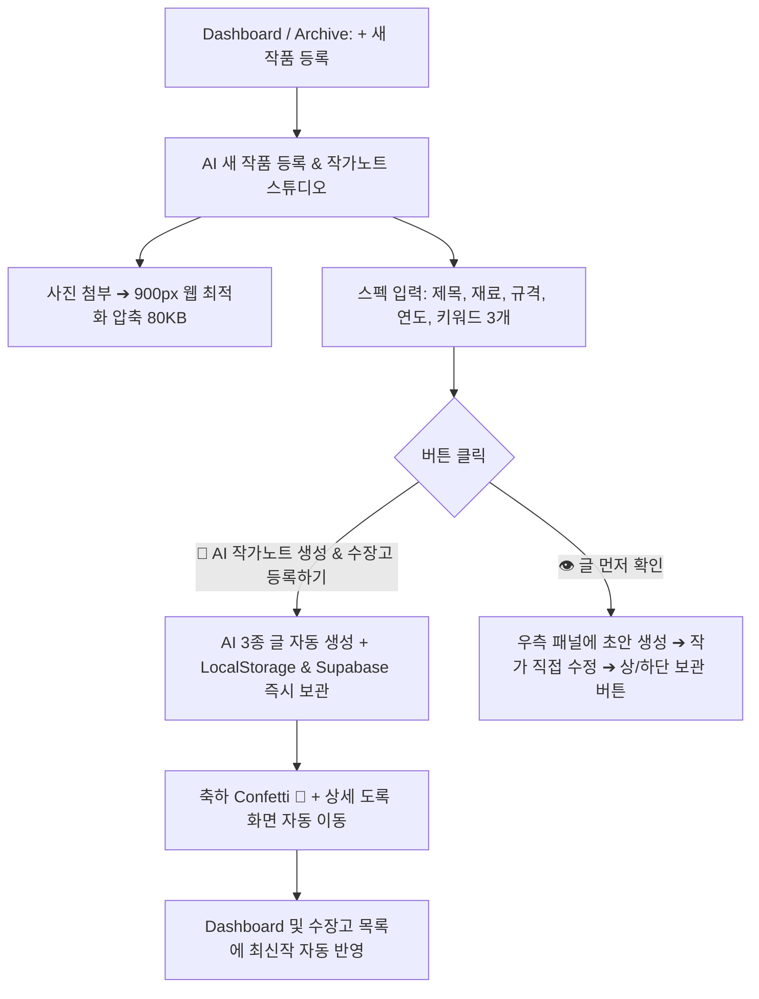

# 🎨 수장고(Sujango) - AI 새 작품 등록 & 작가노트 스튜디오 통합 및 로컬스토리지 최적화 지식 노트

- **서비스명:** Sujango (수장고) - 창작자를 위한 프라이빗 디지털 수장고
- **고유 포트:** 5198
- **저장소:** https://github.com/ARA3827/sujango.git
- **배포:** Vercel 자동 배포 연동 (`main` 브랜치)
- **최종 커밋:** `04bd496`
- **작성일자:** 2026-10-17

---

## 1. 당일 주요 개선 및 문제 해결 내역

### 1-1. '새 작품 등록'과 '작가노트 스튜디오'의 완전한 원스톱 통합
- **기존 문제:**
  - 메인 대시보드에서 `[+ 새 작품 등록]`을 클릭하면 신규 등록 폼이 아닌 이미 등록된 첫 번째 작품(《봄의 품격》)의 상세 도록 페이지가 열리는 혼선 발생.
  - 새 작품 등록 폼과 작가노트 스튜디오의 입력 항목(사진, 제목, 크기, 재료 등)이 중복되어 작업 동선이 파편화됨.
- **해결책:**
  - `StatementStudio.jsx`를 **[AI 새 작품 등록 & 작가노트 스튜디오]**로 전면 고도화.
  - 대시보드 및 수장고 상단에서 `[+ 새 작품 등록]` 클릭 시 다이렉트로 통합 스튜디오로 연결.
  - 작품 정보(사진, 제목, 규격, 재료, 연도, 키워드 3개)를 입력하고 메인 버튼을 누르면 **AI 글 3종(미술평론 작가노트, 전시 캡션, 인스타 피드 글)을 즉시 생성함과 동시에 작가님의 수장고에 원클릭으로 자동 안전 보관**되도록 파이프라인 완성.

### 1-2. 고화질 사진 업로드 시 브라우저 LocalStorage 5MB 한도 방어
- **발생했던 버그:**
  - 사용자가 《맹호도》 고화질 사진을 첨부하고 `[이 작품을 내 수장고에 보관하기]`를 눌렀으나, LocalStorage 5MB 용량 한도 초과(`QuotaExceededError`)로 인해 저장이 거부되어 목록에 반영되지 않는 치명적 실무 문제 발생.
- **해결책:**
  - `compressImage` 파라미터를 `maxWidth: 900, quality: 0.75`로 튜닝하여 육안 화질 손상 없이 이미지 용량을 80~150KB 수준으로 1/10 압축.
  - `archiveStorage.js` 내에서 LocalStorage 저장 시 예외 처리 및 슬림 모드 재시도 방어 로직 구축.

### 1-3. 카피라이팅 & 신뢰감 제고 (AGENTS.md 준수)
- 화면 전체에서 과장되거나 부담스러운 **'영구'** 단어를 전면 제거:
  - `이 작품을 내 수장고에 영구 보관하기` ➔ `이 작품을 내 수장고에 보관하기`
  - `기기에 영구 보관합니다` ➔ `기기에 안전하게 보관합니다`
  - `영구히 보관하세요` ➔ `안전하게 보관하세요`
- 창작배경/영감메모 입력칸의 텍스트를 진한 검은색 기본값 대신 연한 회색의 가이드(placeholder)로 변경하여 지우는 수고 제거.

---

## 2. 핵심 아키텍처 및 데이터 흐름

---

## 3. 1인 창업가 멘토링 핵심 체크리스트
1. **사용자의 직관 존중:** 사용자가 큰 버튼을 눌렀다면 "저장까지 원스톱으로 끝났다"고 느끼는 것이 당연하다. 2번의 클릭이나 스크롤 아래 숨겨진 저장 버튼을 강요하지 말 것.
2. **로컬스토리지 5MB 한계 사전 차단:** 모바일/카메라 고화질 사진은 반드시 클라이언트에서 100KB 미만으로 경량화 압축 후 저장해야 안정적인 서비스 제공 가능.

---

## 4. 서브페이지 7대 핵심 정돈 및 팩트 컴플라이언스 (2026-10-22)

### 4-1. 계정 및 인증 팩트 안내 (1번)
- 현재 계정/인증은 서버나 클라우드가 아닌 **사용자 브라우저 `localStorage`에만 세션 형태로 작동**.
- 비밀번호는 브라우저 로컬스토리지에 평문(Plain text) 저장 중이므로 다른 기기 연동 불가.
- 다음 단계에서 **Supabase 클라우드 열쇠(URL/Anon Key) 연결**을 통해 실제 서버 계정 발급, 이메일 인증, 약관 동의 체크박스(이용약관/개인정보 처리방침) 파이프라인으로 전환 예정.

### 4-2. AI 작가노트 생성 정확성 (`StatementStudio.jsx`)
- 입력칸이 비어 있을 때 placeholder(예시 문구: "빛과 어둠의 경계에서...")가 AI 프롬프트에 들어가 글을 왜곡하던 문제 원천 차단.
- 재료 맞춤 텍스트 생성: '지본채색/한지/종이' 입력 시 한지의 결/스며듦, '유화/아크릴'은 물성의 층위, '도예'는 흙과 불 등 실제 재료를 반영하도록 분기. 미입력 시 '캔버스'를 날조하지 않도록 방어.

### 4-3. 불필요한 이모지 제거 & 신뢰감 확보
- 전시 캡션 출력기 스타일 탭(🏛 ⬛ 🔴) 및 미리보기(✂️, 📄) 이모지 삭제.
- 작가노트 상단 타이틀 `✍️`, 빈 화면 `✨`, `📁` 이모지 제거.
- 로그인창 💡 팁 이모지 제거.

### 4-4. 화면별 용어 및 카피라이팅 통일
- 작가노트 결과 탭 이름 통일: `작가노트 / 인스타그램 캡션 / 블로그 글`.
- 헤더 복귀 버튼: `← 내 수장고`로 직관적 통일.
- 메인 타이틀: `나의 작품 수장고`, 설명: `작품 사진과 작가노트, 캡션 정보를 작품별로 보관하세요.`.
- 수장고 상세 타이틀: `작품 시각 자산` ➔ `작품 이미지`.
- 로그인 모달 하단 `공식 암호화 보안 프로토콜로...` 과장 문구 숨김 처리.

### 4-5. 수장고 상세 (`ArchiveStudio.jsx`, `index.css`)
- `CLOUD_ENABLED = false` 상태에 맞추어 `Pro 배지` ➔ `Pro 베타 신청`으로 사실 기반 표기.
- 실제 이미지 자동 합성이 아직 미완성인 `워터마크 설정` 버튼 주석 숨김 처리.
- 작품 프레임 배경색: 어두운 남색(`#0F172A`) ➔ 밝은 갤러리 회색(`#F1F5F9`)으로 전환하여 다양한 작품 색조 온전 감상.

### 4-6. 전시 캡션 출력기 (`CaptionStudio.jsx`)
- 영문 제목(`titleEn`) 및 영문 재료(`mediumEn`) 입력란 복원 및 수장고 불러오기 연동.
- 수장고에서 이미 불러온 작품은 `수장고에도 함께 보관하기` 체크박스 숨김 처리.
- 인쇄/PDF 출력 시 상단 수장고 연동 안내 배지가 인쇄물에 나오지 않도록 `@media print` 스타일 처리.

### 4-7. 서류·출강 스튜디오 (`DocStudio.jsx`)
- 장르 선택(한국화/서양화/수채화/드로잉/도예/공예 등)에 따라 재료비 기본 규격 자동 세팅, 미입력 시 빈칸 유지, 미리보기 셀 `contentEditable` 지원.
- 강사명 옆 불필요하게 튀는 빨간 원형 도장 테두리 ➔ 단정한 `(인)` 텍스트로 교체.

### 4-8. 창작 가계부 (`TaxStudio.jsx`)
- 4대 요약 카드 타이포그래피 정돈 (금액: `fontSize 1.45rem`, `fontWeight 800`).
- 카드 문구 정돈:
  - 카드 2: `총 N건 집행` ➔ `총 N건`
  - 카드 3: `실질 창작 수익 마진` ➔ `수입에서 지출을 뺀 금액`
  - 카드 4: `상태 뱃지 클릭 시 즉시 변경` 안내문 삭제.

### 4-9. 인지 피로 제거 및 내비게이션 간소화
- 작가노트 스튜디오 하단 불필요한 `이 작품을 수장고에도 함께 보관하기` 체크박스 전면 제거 (기본 안전 보관 유지로 작가 경험 단정화).
- 대시보드 작품 목록 우측 링크 문구 `전체 수장고 열람 →` ➔ 간결하고 직관적인 `전체보기 →`로 정돈.

### 4-10. 한국 전통색 6대 기능 팔레트 중앙화 (`src/constants/themeColors.js`)
- **디자인 철학:** 모든 카드의 배경 밝기(Lightness 94~95%)와 채도를 동일한 수준으로 조율하여 어느 카드도 튀지 않고, 한옥의 창호지와 옛 화폭처럼 그윽하고 단아한 미학 완성.
- **6대 기능 팔레트 매핑:**
  1. **나의 작품 수장고 (먹색 / 墨色):** 배경 `#F4F3F0`, 테두리 `#E4E2DC` (1px), 강조 `#3F3B36`
  2. **전시 캡션 출력기 (쪽빛 / 藍色):** 배경 `#EEF2F6`, 테두리 `#DCE4ED` (1px), 강조 `#3D5A80`
  3. **서류·출강 스튜디오 (송화색 / 松花色):** 배경 `#F6F4E8`, 테두리 `#E7E4D0` (1px), 강조 `#7A6F2E`
  4. **창작 가계부 (황토색 / 黃土色):** 배경 `#F8F1E6`, 테두리 `#EADECF` (1px), 강조 `#A0703A`
  5. **작가노트 & SNS (연지색 / 臙脂色):** 배경 `#F7EFEF`, 테두리 `#E8DCDC` (1px), 강조 `#9E5A5A`
  6. **영감 노트 (청자색 / 靑磁色):** 배경 `#EEF4F1`, 테두리 `#DCE7E1` (1px), 강조 `#4F7F6E`
- **일원화 시스템:**
  - 메인페이지 6대 카드와 대시보드 도구 카드의 배경, 1px 테두리, 태그 글자색(강조색), 아이콘 타일 색상이 `themeColors.js` 단 한 곳에서 통합 관리되도록 아키텍처 완성.

---

## 5. 구글 소셜 로그인 직행(선택지 B) 및 이메일 중복 확인 강화 (2026-10-22)

### 5-1. 구글 소셜 로그인 직행 (UX 마찰 제로화)
- **개편 배경:**
  - 구글 소셜 로그인 시 작가명/활동명을 다시 묻는 중간 모달(`profile_setup`)이 나타나 사용자의 첫 진입 흐름이 끊기던 불편함 해소.
  - 최신 웹/앱 트렌드(선택지 B)에 맞추어 구글 계정 선택 즉시 대시보드로 원클릭 직행하도록 개편.
- **구현 방식:**
  - 구글 프로필의 이름(`googleUser.name`) 또는 이메일 아이디를 닉네임으로 자동 부여하고 로컬 볼트에 저장.
  - 기존 등록 작가의 경우 기설정된 고유 활동명을 영구 보존한 채 즉시 입장.
  - 이후 활동명 변경은 대시보드 우측 상단 프로필/설정에서 언제든 자유롭게 수정 가능.

### 5-2. 이메일 회원가입 중복 가입 3단계 철벽 방어
1. **1단계 (실시간 인라인 감지):**
   - 회원가입 입력창에서 이메일 입력 중 브라우저 로컬 볼트에 등록된 이메일이 감지되면 테두리가 부드러운 주황색으로 표시되며 하단에 `이미 등록된 이메일 주소입니다. [기존 계정으로 로그인 →]` 바로가기 링크 즉각 노출.
2. **2단계 (클라우드 Supabase 중복 차단):**
   - Supabase `signUpWithEmail` 호출 시 이메일 열거 방지 모드(`identities.length === 0`) 및 `User already registered` 에러를 명확히 캐치하여 로컬 가입으로 무분별 폴백되지 않고 단정한 한글 안내 메시지 표시.
3. **3단계 (원클릭 로그인 모드 전환):**
   - 에러 박스에 `[기존 계정으로 로그인하기 →]` 버튼을 제공하여, 클릭 시 입력해 둔 이메일 주소가 그대로 유지된 채 비밀번호만 입력하면 즉시 로그인할 수 있도록 UX 연결.

---

## 6. 개인정보 보호, 가입 환영 화면 및 활동명·이메일 듀얼 중복 철벽 방어 (2026-10-22)

### 6-1. 활동명 예시 개인정보 사용 금지 및 전역 정돈
- **조치 내역:**
  - 회원가입 폼 및 프로필 설정의 `예: 아라작가 / 멜로디` placeholder를 완전 삭제하고 중립적인 `활동명 또는 작가명을 입력하세요`로 통일.
  - 가이드 페이지 및 아카이브 더미 데이터 내 개인 식별 해시태그(`#아라작가`, `#김아라작가`)를 `#신진작가`, `#청년작가`로 치환하여 개인정보 노출 원천 차단.

### 6-2. 회원가입 완료 축하 환영 화면 (`viewMode === 'signup_success'`)
- **UX 개선:**
  - 단순 모달 닫힘 및 폭죽 발사에서 벗어나, 회원가입 완료 시 전용 축하 화면 제공.
  - 초록색 인증 배지, 축하 폭죽, 활동명 및 등록 계정 확인 카드, `[내 수장고 바로 입장하기 →]` 액션 버튼을 통해 사용자가 안전하게 가입되었음을 직관적으로 체감.

### 6-3. 활동명(아이디) & 이메일 듀얼 중복 방어 시스템 구축
- **문제 진단:**
  - 기존에는 이메일 중복만 검사하고 있어 동일한 활동명(아이디)으로 가입 시 연속 가입되는 현상 발생.
- **해결책:**
  - `findRegisteredUserByName` 헬퍼 함수 신설 및 `registerLocalUser` 내 활동명 고유성 검증 추가.
  - 가입 입력 폼에서 이메일뿐만 아니라 활동명 입력 시에도 실시간으로 중복 여부를 감지하여 인라인 경고 안내 제공.
  - 이메일 또는 활동명 중 하나라도 중복되면 가입을 즉시 차단하고 친절한 한글 안내 메시지 표시.

### 6-4. 구글 회원가입 시 기존 계정 감지 및 확인 화면 (`viewMode === 'already_registered'`)
- **문제 진단:**
  - 이미 가입된 구글 계정으로 [회원가입] 창에서 [구글로 회원가입]을 누르면, 중복 감지 안내 없이 조용히 로그인되어 버려 사용자가 "또 회원가입이 된 것인지" 혼선을 겪음.
- **해결책:**
  - 사용자가 [회원가입] 모드에서 이미 등록된 구글 계정을 선택할 경우, 즉시 로그인을 진행하지 않고 **[기존 계정 감지] 안내 화면**으로 전환.
  - "Renee R 작가님은 이미 수장고에 등록되어 있습니다" 안내 및 계정 정보 확인 카드와 함께 `[기존 계정으로 수장고 입장하기 →]` 명시적 버튼을 제공하여 완벽한 사용자 통제감 확보.
  - 반대로 [로그인] 모드에서 구글 로그인을 누르면 대시보드로 즉시 직행하도록 모드별 최적 분기 처리 완료.

---

## 7. 수장고 회원 탈퇴 및 데이터 영구 파기 파이프라인 (2026-10-22)

### 7-1. 비즈니스 멘토 관점 및 법적 컴플라이언스
- **배경:** 개인정보보호법 및 구글 플레이/앱스토어/전자상거래 가이드라인에 따르면, 회원가입 기능이 있는 서비스는 반드시 이용자가 직접 계정을 탈퇴하고 개인 데이터를 영구 파기할 수 있는 투명한 절차를 갖추어야 함.
- **2단계 안전장치:** 단순 클릭 한 번으로 탈퇴되어 소중한 작품 자산이 날아가는 사고를 막기 위해, 명확한 파기 항목 고지 + 필수 동의 체크박스 + 탈퇴 확정 버튼의 2단계 확인 프로세스 구축.

### 7-2. 파기 데이터 범위 및 로컬 격리 스토리지 청소 (`deleteUserAccount`)
- **파기 범위:**
  1. 전체 등록 회원 DB(`sujango_registered_users_vault`)에서 해당 계정 영구 삭제
  2. 작가 계정별 스코프 로컬스토리지 8종 완전 삭제:
     - `artflow_artworks_${safeEmail}` (작품 목록)
     - `artflow_artworks_raw_vault_${safeEmail}` (고화질 이미지 원본)
     - `artflow_captions_${safeEmail}` (전시 캡션)
     - `artflow_tax_records_${safeEmail}` (세무/정산 내역)
     - `artflow_inspo_notes_${safeEmail}` (영감 서랍 메모)
     - `artflow_doc_profile_${safeEmail}` (서류 프로필 정보)
     - `artflow_watermark_${cleanEmail}` (나만의 워터마크 설정)
     - `sujango_migrated_v1_${safeEmail}` (마이그레이션 플래그)
  3. 현재 활성 로그인 세션 초기화 (`artflow_user` 삭제)
- **효과:** 동일한 이메일이나 활동명으로 추후 재가입하더라도 이전 데이터의 잔재 없이 깨끗한 초기 상태에서 새로 시작 가능.

---

## 8. 글로벌 약관 점검 및 개인정보 국외 이전(해외 위탁) 법정 고지 체계화 (2026-10-22)

### 8-1. 문제 진단 및 글로벌 컴플라이언스 배경
- **문제점:**
  - 글로벌 창작자를 타깃으로 하면서도, 기존 개인정보 처리방침에는 Supabase(인도 뭄바이)만 단편적으로 기재되어 있었음.
  - 실제 서비스 구동 시 인공지능(Google Gemini API) 및 글로벌 호스팅 CDN(Vercel Inc.)을 통해 미국 등 해외 서버로 데이터가 전송·처리되나 이에 대한 법정 고지가 누락됨.
- **법적 요건 (개인정보보호법 제28조의8):**
  - 계약 이행을 위한 위탁은 처리방침 공개로 동의를 갈음할 수 있으나, **[이전받는 자, 관련 근거, 이전 항목, 이전 국가, 이전 시기·방법, 이용목적, 보유기간, 거부 방법·절차·효과]**를 모두 명시해야 함.

### 8-2. 개편된 3대 해외 인프라 법정 고지 표 (`PRIVACY_POLICY` 제3조)
1. **Supabase, Inc. (미국 / 인도 뭄바이 리전):** 계정 인증, 회원 메타데이터, 창작 서류/정산 DB 및 동기화 백업 (회원 탈퇴 시까지)
2. **Google LLC (미국 글로벌 데이터센터):** AI 작가노트 생성 시 입력한 작품 텍스트 분석 (개인식별정보 일절 미전송, 추론 완료 즉시 응답 반환 및 세션 파기, AI 학습 미활용)
3. **Vercel Inc. (미국 엣지 네트워크):** 웹 호스팅, 엣지 CDN 캐싱, 접속 로그 및 DDoS 보안 방어 (접속 보안 정책에 따라 최대 30~90일 보관 후 파기)

---

## 9. 약관 3종 전문 교체, 회원가입 필수 동의 3종 체크박스 및 구글 동의 브릿지 탑재 (2026-10-22)

### 9-1. [1단계] 약관 3종 전문 교체 및 대괄호 완전 해소 (`policyTexts.js`)
- **공통 시행일:** `2026년 10월 31일`
- **보호책임자:** 한서희 대표 (`auth@sujango.com`)
- **서비스 이용약관:** 제1조(목적) ~ 제14조(준거법과 분쟁해결) 및 부칙, 무료 회원 브라우저 저장 한계 및 JSON 백업 명문화
- **개인정보 처리방침:** 1조 ~ 14조 및 부칙, 3대 국외 이전(Supabase 서울/미국, Vercel 미국, Google 미국) 법정 표 및 거부 절차 규정
- **구독 결제 및 환불 규정:** 현재 베타 기간으로 유료 결제를 청구하지 않는다는 원칙 명문화 및 향후 상용화 전환 시 적용될 환불 규정(청약철회 7일, 중도해지 계산식) 부록 예고
- **품질 검증:** 텍스트 내 대괄호(`[...]`) 플레이스홀더 잔존 0건 전수 검증 통과

### 9-2. [2단계] 회원가입 필수 3종 동의 체크박스 & 구글 가입 동의 브릿지 (`LoginModal.jsx`)
- **이메일 회원가입:**
  - `[필수] 이용약관 동의 (보기)`
  - `[필수] 개인정보 수집·이용 동의 (보기)`
  - `[필수] 만 14세 이상입니다`
  - 전체 동의 체크박스 제공, 3개 필수 항목 미체크 시 [회원가입 완료] 버튼 비활성화
- **구글 소셜 회원가입:**
  - 신규 가입자 감지 시 `viewMode === 'google_agreement'` 화면으로 분기
  - 구글 프로필(이름, 이메일) 확인 후 서비스 시작 전 동일한 3대 필수 약관 동의 절차 1회 강제
  - 가입 완료 시 `termsAgreedAt`, `privacyAgreedAt`, `policyVersion: '2026-10-31'` 메타데이터 영구 보관

### 9-3. [3단계] Supabase profiles 테이블 동의 이력 보관 SQL DDL 및 RLS
- 가입일시와 별개로 이용약관/개인정보 동의 일시 및 약관 버전 컬럼 신설
- Column-Level 보안 및 RLS(Row Level Security)를 통한 동의 기록 위변조 방어

---

## 10. Supabase 클라우드 실연동 1단계 인프라 & 약관 동의 DDL 고도화 (2026-10-24)

### 10-1. 실제 클라우드 프로젝트(Sujango's Project) 확인 및 클라이언트 활성화
- **현황 확인:**
  - 사용자 Supabase 대시보드 스크린샷 검증 결과, 이미 `Sujango's Project`(`https://tkzacvmcqpytludkdpm.supabase.co`)가 `Healthy (STATUS)` 상태로 정상 개설되어 있었음.
- **조치:**
  - `src/utils/supabaseClient.js`의 안전 가드(`!url.includes('tkzacvmcqpytludkdpm')`)를 즉시 해제하고, 실제 Supabase 클라이언트 인스턴스가 즉각 활성화되도록 연동 완료.

### 10-2. 데이터베이스 스키마 약관 동의 4대 컬럼 반영 (`supabase_schema.sql`)
- **반영 컬럼:**
  1. `terms_agreed_at TIMESTAMPTZ`: 이용약관 동의 일시
  2. `privacy_agreed_at TIMESTAMPTZ`: 개인정보 수집/이용 동의 일시
  3. `policy_version TEXT DEFAULT '2026-10-31'`: 동의 당시 적용 약관 버전
  4. `is_over_fourteen BOOLEAN DEFAULT TRUE`: 만 14세 이상 확인 여부
- **안전 마이그레이션:**
  - 신규 생성뿐만 아니라 이미 `profiles` 테이블이 존재하는 경우를 대비해 `ALTER TABLE public.profiles ADD COLUMN IF NOT EXISTS ...` 구문 완비.

### 10-3. 작가 프로필 동기화 파이프라인 연동 (`syncUserProfile`)
- 회원가입 시 클라이언트에서 수집된 약관 동의 메타데이터(`user.termsAgreedAt`, `user.privacyAgreedAt`, `user.policyVersion`, `user.isOverFourteen`)를 Supabase `profiles` 테이블로 함께 upsert하도록 파이프라인 연결 완료.
